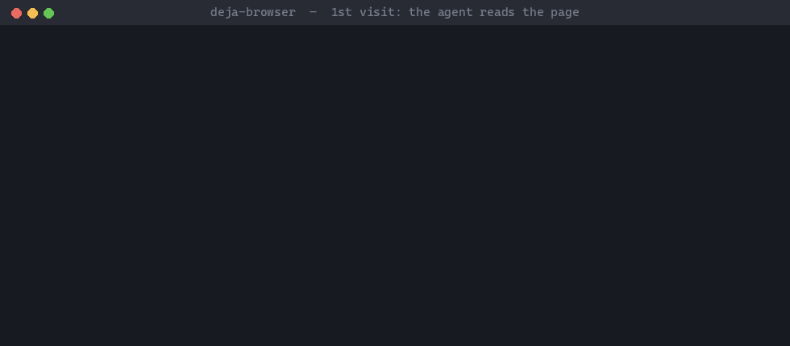

# deja-browser

**Your AI agent gets its own browser — and remembers each site, so the next visit skips reading the page (~50× less text in the demo below).**

[](https://pypi.org/project/deja-browser/)
[](https://pypi.org/project/deja-browser/)
[](https://github.com/drpwchen/deja-browser/blob/main/LICENSE)



*A real run against hn.algolia.com: first visit 29,427 characters of page for the model to read,
recipe replay 588 characters of JSON. Wall time (median of 3) 3.5 s plus model reading vs 1.1 s.*

- **Learn once, replay.** The first visit finds the site's JSON endpoint or form and saves it as a
  *recipe*; later visits replay it without reading the page — **~50× less text** for the model in the demo above.
- **Not your browser.** A separate Chromium profile driven over CDP on `127.0.0.1`. No extension
  in your everyday browser; your mail, bank and broker are simply not logged in there.
- **No telemetry, tested.** [`tests/egress/run.sh`](https://github.com/drpwchen/deja-browser/blob/main/tests/egress/run.sh)
  traces every `connect()` in a loopback-only network namespace and fails on anything else.
- **No passwords in the browser.** Secrets stay in your OS keyring or password-manager CLI;
  recipes only name them.

Works with any agent that can run shell commands — Claude Code, Codex CLI, Gemini CLI, Cursor,
Aider — and from plain Python. MIT. **Pre-1.0**: tested on Windows 11 (Edge), macOS on
Apple Silicon (Chrome) and Linux (headless Chromium); the background daemon added in 0.4 so far
only on Windows and headless Linux.

## Quick start

**Requirements & cost.** Python ≥ 3.11 and an installed Edge, Chrome, Chromium or Brave (Windows, macOS or Linux). Free (MIT), no accounts, no API keys; the only optional paid-account feature is the opt-in hCaptcha solver, which uses your own Gemini key.

```sh
pip install "deja-browser[stealth,keyring]"

deja-cdp launch                                                     # start the agent's browser
deja-cdp navigate '{"url": "https://example.com"}' --session demo
deja-cdp snapshot '{"max_chars": 2000}' --session demo              # what the agent reads
deja-cdp close_session '{}' --session demo                          # closes only this session's tabs
```

Each command prints one line of JSON; the `snapshot` line holds the page text, cut to 2000 characters.

Or let your agent do the setup. Tell it: *"Read
https://github.com/drpwchen/deja-browser/blob/main/AGENTS.md and set this up with me."* It asks you
the few choices that matter, has you log in to your sites by hand, and runs a smoke test.

> 🧋 Saved you some time? [Buy me a drink](https://drpwchen.com/en/support/).

## Your first recipe

The shortest way: do the task once through `deja-cdp` (a background daemon records the visit), then
call `deja-browser learn --name <name> --session <task> --expect "<text from the answer>"`, which
drafts, verifies and saves the recipe in one step (`deja-browser help learn`).

The explicit way: capture the JSON request the site makes, and let `draft` write the recipe from it.
The example is the site in the GIF (Hacker News search, through its public JSON API):

```sh
deja-cdp network_capture '{"trigger":{"navigate":"https://hn.algolia.com/api/v1/search?query=rust"},"url_filter":"api/v1/search","types":"all"}' --session hn-draft > capture.json
deja-browser draft capture.json --expect Rust --param q=rust --out draft.json   # writes draft.json
deja-browser verify draft.json '{"q": "rust"}'          # try every tier, print shape + preview
deja-browser save draft.json                            # only after a passing verify of this draft
deja-browser run hn.algolia.com/search '{"q": "rust"}'  # replay: titles + URLs, no page read
```

`--expect` is a string the answer must contain (at least 3 characters); `--param` is the value you
used during the capture, so the draft turns it into `{q}`. The draft has `TODO` fields for
`when_to_use` and the param description: fill them in before `save`. If the page's data is in the
HTML rather than a JSON response, `draft` prints `"applicable": false` and exits with code 2 — then
write a `script` recipe instead (a DOM read; `deja-cdp read` finds the text on the page).

If you would rather write the recipe by hand, this is the same example (a minimal recipe for the
site in the GIF, using its public JSON API):

```json
{
  "name": "search",
  "description": "Hacker News full-text search (example)",
  "entry_url": "https://hn.algolia.com/",
  "params": [{"name": "q", "required": true}],
  "request": {"method": "GET", "url": "https://hn.algolia.com/api/v1/search?query={q}"},
  "pick": {"path": "hits", "fields": ["title", "url"], "limit": 20},
  "writes": false
}
```

```sh
deja-browser verify draft.json '{"q": "rust"}'          # try every tier, print shape + preview
deja-browser save draft.json                            # only after a passing verify of this draft
deja-browser run hn.algolia.com/search '{"q": "rust"}'  # replay: titles + URLs, no page read
deja-browser list
```

No recipes ship with the package — you (or your agent) build them per site from the first visit
(`learn`, or `network_capture` plus `draft`). Recipes live in `<recipes dir>/<host>/<name>.json` and are
addressed as `<host>/<name>`. `deja-browser help format` documents the full format.

## Compared with other agent browsers

Measured on one Windows 11 PC in November 2026: five public pages (a search page backed by a JSON API, a large
Wikipedia table, a two-step server-side form, a JavaScript single-page app, a Cloudflare demo page), three visits
each with different parameters, n = 3. "Chars" is what the tool handed back to the model. Small benchmark, not a
ranking; conditions and raw method in [docs/benchmark.md](https://github.com/drpwchen/deja-browser/blob/main/docs/benchmark.md).

| | deja-browser 0.4 | agent-browser 0.43 | Ego Lite 0.6.3 | Claude in Chrome |
|---|---|---|---|---|
| What it is | Python CLI + background daemon over CDP | Rust CLI + per-session daemon | a Chromium-based browser with a built-in agent service | an extension in your own Chrome |
| Whose logins the agent sees | its own profile, logged in only to the sites you chose | a fresh profile per session (as run here) | the logins in that browser | everything you are logged in to in Chrome |
| What a repeat visit reuses | a recipe saved by `learn` (HTTP call, page script, or recorded steps) | a recorded flow (`flow save`) | nothing: reads the page again | nothing: reads the page again |
| Repeat visit, chars (4 pages without Cloudflare, scripted) | **104–3,346** (recipe) | flow replay worked on 1 of 4 pages (50,793); re-read 6,417–26,766 | re-read 3,134–20,465 | model-driven run: 8.6–24.6× deja (1.6–2.9× without the tab list it appends) |
| Repeat visit, seconds (same) | 0.4–1.0 when the recipe's tab is open; 1.4–2.1 when it opens a new one | 0.6–1.6 | 0.7–4.5 | not comparable (timed from the chat log) |
| First visit, seconds per read (same) | 1.8–4.3 | 2.0–2.8 | 1.0–4.0 | not comparable |
| First visit, chars per read (same) | 3,012–22,775 | 3,170–26,766 | 2,830–20,465 | — |
| First visits, model-driven (5 pages, same prompt, Claude Opus) | 8,979 chars, recipes saved for 4 of the 5 pages | not measured | not measured | 9,854 chars (2,947 without the tab list); nothing saved |
| Cloudflare demo page | 9/9 (built-in gate ticks the checkbox) | 0/63 with a scripted click | every visit with a scripted click | stops at the challenge, by design |
| Old-style pages (dialogs, frames, popups) | reported and handled; 35 checks on a local fixture | an `alert` froze the tab for 30 s, then it was replaced by a blank tab | not measured | not measured |
| Outbound traffic of its own | none, checked by an egress test | not measured | not measured | not measured |

Where deja is behind: agent-browser and Ego Lite were each faster on first visits to three of the four pages, and a
recipe's first run in a session (new tab) takes 1.4–2.1 s on three of them. The pages were used while 0.4 was
developed, deja and Ego Lite ran on long-lived profiles (agent-browser on fresh ones, which matters for
Cloudflare), and the Claude in Chrome figures come from the 0.3.0 round.

## What it does

- **Dedicated profile, any Chromium.** Edge, Chrome, Chromium or Brave (auto-detected) over CDP on
  `127.0.0.1` only, with its own user-data dir. Kimi-WebBridge-compatible action names and return
  shapes, so scripts written for that bridge port over.
- **Named sessions.** Every task names a session; its tabs are tracked across processes and
  `close_session` closes only those.
- **Cheap to read.** Snapshots can be cut to one subtree, to interactive elements, or to lines
  matching a word; screenshots and PDFs come back as file paths, never as inline images.
- **API discovery.** `network_capture` records the requests one action triggers (bodies to files,
  credential headers redacted) — the raw material for a recipe.
- **Recipe tier ladder**, cheapest first, falling through on failure and recording what worked:
  `http` (plain HTTP outside the browser, cookies read live from the browser, never stored) →
  `page` (`fetch()` in a tab on the site: native cookies, Cloudflare clearance, CSRF) → `script`
  (the recipe's own JavaScript in the page: DOM read / form fill). Flows with no JSON API that
  cross page loads, frames and popups are saved as `steps` recipes (browser actions replayed in order).
- **Shape checks.** Every response is compared with the JSON shape recorded at verify time; a
  mismatch is reported as *stale*, never returned as data.
- **Write guard.** Recipes with side effects (`"writes": true`) only run with `--allow-write`.
- **Secrets by name.** Recipes reference `{secret:NAME}`; values are resolved in-process, never
  printed or returned, and never typed into a refused host.
- **No passwords in the profile.** On launch its password, card and address autofill is turned
  off, and a password-manager extension installed in it triggers a warning.
- **CAPTCHA gate.** Waits for Turnstile / Cloudflare to clear, then tries one trusted checkbox
  click. Local solvers (reCAPTCHA audio via `faster-whisper`, text CAPTCHAs via `ddddocr` — also
  the `captcha_text` action for login forms) run only
  if you install those extras; the hCaptcha solver only if you enable it. Otherwise it notifies you.
  `deja-browser gate <url>` opens a URL, clears any challenge and reports.
- **Guard rails.** `navigate` and recipes refuse mail, account sign-in, banking, brokerage and
  payment hosts (built-in list, extendable, on by default; `[recipes] deny_hosts_enabled = false`
  switches it off); recipes also refuse ticketing / rail-booking hosts by default. These stop
  accidents, not attackers — see *Safety model*.

## Options at a glance

| | Options | Notes |
|---|---|---|
| OS | Windows, macOS, Linux | Linux tested headless only |
| Browser | Edge, Chrome, Chromium, Brave, any Chromium (`[browser] executable`) | no Firefox / Safari (no CDP) |
| Driver | `patchright` (extra `stealth`, used when installed), `playwright` | patchright passes more bot checks |
| Secrets | `keyring` (default), `command`, `env`, `python` | `command` runs 1Password `op`, Bitwarden `bw`, macOS `security`, `pass`, … |
| Notifications | ntfy URL, any command, stderr (default) | for "a human is needed" |
| CAPTCHA extras | `audio` (local), `ocr` (local), hCaptcha solver (cloud, opt-in) | none installed by default |
| Agents | anything with a shell; Agent Skills folder in `skills/deja-browser/` | Python API: `from deja_browser.browser import wb` |

## Install

Requires Python ≥ 3.11 and a Chromium-based browser. `deja-browser` uses your installed browser;
it does not need `playwright install`.

```sh
pip install deja-browser                      # core (playwright driver)
pip install "deja-browser[stealth,keyring]"   # recommended: patchright driver + OS keyring secrets
pip install "deja-browser[audio,ocr]"         # reCAPTCHA audio (faster-whisper), text CAPTCHAs (ddddocr)
pip install -e ".[dev]"                       # from a clone: core + pytest
python -m playwright install-deps             # Linux only, if system libraries are missing
```

From Python:

```python
from deja_browser.browser import wb
wb("navigate", {"url": "https://example.com"}, session="task")
wb("snapshot", {"max_chars": 4000}, session="task")
wb("close_session", {}, session="task")
```

`deja-cdp --help` lists the actions; `deja-cdp help <action>` gives one action's arguments and reply.

## Safety model

What protects you is **separation**: the agent profile is never logged in to mail, banking or
brokerage, and stores no passwords. The refused-host list is a guard rail: it stops an agent from
navigating there by mistake and keeps stored secrets from being typed into those sites, but a page
script can still redirect the tab, and an agent with shell access can edit your config. Treat it
as a seat belt, not a lock.

You can take the seat belt off: `[recipes] deny_hosts_enabled = false` (default `true`) turns the
refused-host list off, built-in entries and `deny_hosts_extra` alike. Then `navigate` and recipes
open mail, bank and broker pages, and a recipe's login step may type stored secrets into them.
This suits a setup where the agent should fill a bank's public form (say, a card-promotion sign-up)
but has no account there: keep it that way — never log the profile in to those sites and never
store their passwords as secrets — because that separation is now the only protection. The
ticketing list is a separate setting and stays on.

Password managers: do not install their extension in the agent profile — while unlocked it can
fill any saved password for whatever is driving the page. To let the agent log in to a few
low-risk sites by itself, give it a dedicated vault through the password manager's CLI
(`[secrets] backend = "command"`, see `config.example.toml`). 1Password service accounts can be
limited to one vault; an unlocked Bitwarden CLI can read the whole vault.

No telemetry: `tests/egress/run.sh` runs every action and a full recipe cycle inside a network
namespace with only loopback, once in-process and once through the background daemon (traced from
its start, with `learn` and a learned recipe), traces every `connect()` of the tool's processes, and fails on
anything that is not `127.0.0.1` (its `SELFTEST=1` mode proves the check catches a deliberate
connection). The only outbound features are ones you switch on: ntfy notifications and the opt-in
hCaptcha solver.

Two things no tool can change: the browser vendor's own services (e.g. Safe Browsing / SmartScreen
URL checks) still apply to the agent profile, and whatever page content your agent reads goes to
its model provider. Keep sensitive pages (health records, personal data) out of agent sessions.

## Configuration

Optional. Copy `config.example.toml` to:

| OS | Path |
|---|---|
| Windows | `%APPDATA%\deja-browser\config.toml` |
| macOS | `~/Library/Application Support/deja-browser/config.toml` |
| Linux | `~/.config/deja-browser/config.toml` |

or point `DEJA_BROWSER_CONFIG` at a file. It covers the browser executable and profile, the
recipes directory, extra denied hosts, the secret backend (`keyring` / `command` / `env` /
`python`), and notifications (an ntfy URL or any command; default is stderr).

If the CDP port (`port`, default 9222) is already taken by another browser, `deja-cdp` does not stop
there: a browser left behind by deja-browser's own test suite is closed, and anything else is left
running while the agent browser starts on the next free port, remembered in `<profile>/.deja-cdp-port`.

## hCaptcha solver (opt-in, cloud)

Off by default. When enabled, the CAPTCHA gate hands hCaptcha to
[hcaptcha-challenger](https://github.com/QIN2DIM/hcaptcha-challenger), which asks Google Gemini to
answer the challenge. **This sends the cropped challenge image to Google** under your own API key
(not the page, not cookies). hcaptcha-challenger is GPL-3.0 and is not bundled — install it
yourself:

```sh
pip install "hcaptcha-challenger @ git+https://github.com/QIN2DIM/hcaptcha-challenger@28ee79b"
keyring set deja-browser GEMINI_API_KEY        # or your configured secret backend
```

```toml
[captcha]
hcaptcha_solver = "gemini"
```

Best effort: on the public demo the "drag the missing item into the grid" type passed 13/15, the
hexagon shape-matching type 1/5 (small samples). Failures fall through to the human step.

## Limitations

- Pre-1.0: commands and the recipe format may still change. Linux is tested headless only, and the 0.4 daemon not yet on macOS; Firefox and Safari are not supported (no CDP).
- Recipes are built per site by you or your agent; none ship with the package, and a site change can make a recipe stale (reported as stale, never returned as data).
- The refused-host list is a guard rail, not a lock (see Safety model).
- The CAPTCHA gate is best effort: the hCaptcha solver is opt-in and its pass rates above are from small samples. When it fails, it asks a human.
- Page content your agent reads goes to its model provider; keep sensitive pages out of agent sessions.

## Acceptable use

This is a personal automation tool for sites and accounts you are entitled to use. Respect each
site's terms of service and rate limits. Do not use it for ticket scalping, mass account
creation, credential stuffing, or to defeat protections on systems you do not own. Ticket and
rail-booking sites are refused by default: several jurisdictions criminalise automated ticket
purchase (e.g. Taiwan's Railway Act art. 65). `[recipes] allow_ticket_hosts` can lift that; we
recommend you don't, and the decision and its consequences are yours. The project
does not integrate paid CAPTCHA-solving services and will not.

## Tests

```sh
python -m pytest -q               # pure functions; no browser, no network
sudo PY=$(which python) tests/egress/run.sh            # Linux: no outbound connection (needs strace)
sudo PY=$(which python) SELFTEST=1 tests/egress/run.sh # must FAIL: proves the check catches one
```

## License

MIT — see [`LICENSE`](https://github.com/drpwchen/deja-browser/blob/main/LICENSE). Optional
dependencies keep their own licenses; GPL-licensed packages are never vendored into this
repository.

## Support 支持

If this tool helped you, you can [buy me a drink](https://drpwchen.com/en/support/) 🧋
覺得這個工具有幫助嗎？歡迎[請我喝飲料](https://drpwchen.com/support/)。
