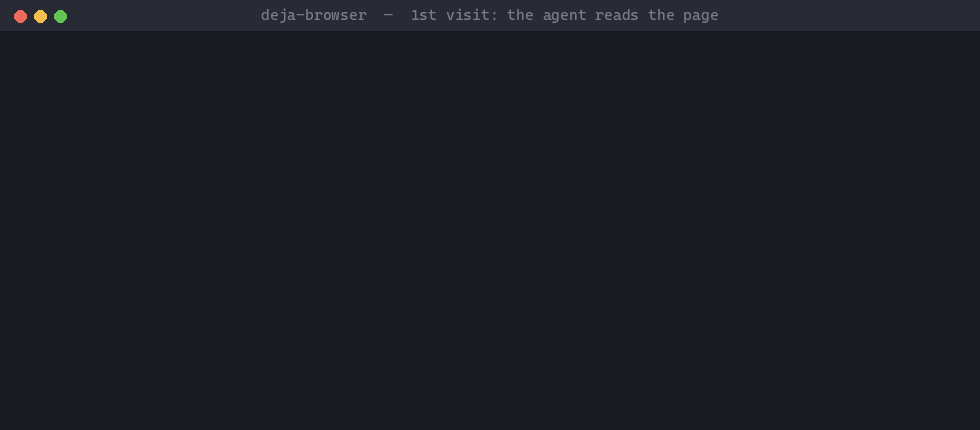

# deja-browser

**Your AI agent gets its own browser — and remembers each site, so the next visit skips reading the page (~50× less text in the demo below).**

[](https://pypi.org/project/deja-browser/)
[](https://pypi.org/project/deja-browser/)
[](https://github.com/drpwchen/deja-browser/blob/main/LICENSE)



*A real run against hn.algolia.com: first visit 29,427 characters of page for the model to read,
recipe replay 588 characters of JSON. Wall time (median of 3) 3.5 s plus model reading vs 1.1 s.*

- **Learn once, replay.** The first visit finds the site's JSON endpoint or form and saves it as a
  *recipe*; later visits replay it without reading the page — **~50× less text** for the model.
- **Not your browser.** A separate Chromium profile driven over CDP on `127.0.0.1`. No extension
  in your everyday browser; your mail, bank and broker are simply not logged in there.
- **No telemetry, tested.** [`tests/egress/run.sh`](https://github.com/drpwchen/deja-browser/blob/main/tests/egress/run.sh)
  traces every `connect()` in a loopback-only network namespace and fails on anything else.
- **No passwords in the browser.** Secrets stay in your OS keyring or password-manager CLI;
  recipes only name them.

Works with any agent that can run shell commands — Claude Code, Codex CLI, Gemini CLI, Cursor,
Aider — and from plain Python. MIT. **Early release (0.1)**: tested on Windows 11 (Edge), macOS on
Apple Silicon (Chrome) and Linux (headless Chromium).

## Quick start

```sh
pip install "deja-browser[stealth,keyring]"

deja-cdp launch                                                     # start the agent's browser
deja-cdp navigate '{"url": "https://example.com"}' --session demo
deja-cdp snapshot '{"max_chars": 2000}' --session demo              # what the agent reads
deja-cdp close_session '{}' --session demo                          # closes only this session's tabs
```

Or let your agent do the setup. Tell it: *"Read
https://github.com/drpwchen/deja-browser/blob/main/AGENTS.md and set this up with me."* It asks you
the few choices that matter, has you log in to your sites by hand, and runs a smoke test.

## Your first recipe

Save this as `draft.json` (a minimal recipe for the site in the GIF, using its public JSON API):

```json
{
  "name": "search",
  "description": "Hacker News full-text search (example)",
  "entry_url": "https://hn.algolia.com/",
  "params": [{"name": "q", "required": true}],
  "request": {"method": "GET", "url": "https://hn.algolia.com/api/v1/search?query={q}"},
  "pick": {"path": "hits", "fields": ["title", "url"], "limit": 20},
  "writes": false
}
```

```sh
deja-browser verify draft.json '{"q": "rust"}'          # try every tier, print shape + preview
deja-browser save draft.json                            # only after a passing verify of this draft
deja-browser run hn.algolia.com/search '{"q": "rust"}'  # replay: titles + URLs, no page read
deja-browser list
```

No recipes ship with the package — you (or your agent) build them per site, usually from a
`network_capture` of the first visit. Recipes live in `<recipes dir>/<host>/<name>.json` and are
addressed as `<host>/<name>`. `deja-browser --help` documents the full format.

## Compared with browser-extension bridges

| | Extension bridge | deja-browser |
|---|---|---|
| Where the agent acts | an extension with full debugger access, inside the browser where you are logged in to everything | its own profile, logged in only to the sites you chose |
| Keeping it off sensitive sites | browsers no longer let you fence such extensions away from chosen sites | those sites are simply not logged in; a refused-host list as a guard rail |
| Outbound traffic | some phone home with no way to turn it off | none of its own, checked by an egress test |
| Repeat visits | read the page again | replay a recipe (~50× less text in the demo) |

## What it does

- **Dedicated profile, any Chromium.** Edge, Chrome, Chromium or Brave (auto-detected) over CDP on
  `127.0.0.1` only, with its own user-data dir. Kimi-WebBridge-compatible action names and return
  shapes, so scripts written for that bridge port over.
- **Named sessions.** Every task names a session; its tabs are tracked across processes and
  `close_session` closes only those.
- **Cheap to read.** Snapshots can be cut to one subtree, to interactive elements, or to lines
  matching a word; screenshots and PDFs come back as file paths, never as inline images.
- **API discovery.** `network_capture` records the requests one action triggers (bodies to files,
  credential headers redacted) — the raw material for a recipe.
- **Recipe tier ladder**, cheapest first, falling through on failure and recording what worked:
  `http` (plain HTTP outside the browser, cookies read live from the browser, never stored) →
  `page` (`fetch()` in a tab on the site: native cookies, Cloudflare clearance, CSRF) → `script`
  (the recipe's own JavaScript in the page: DOM read / form fill).
- **Shape checks.** Every response is compared with the JSON shape recorded at verify time; a
  mismatch is reported as *stale*, never returned as data.
- **Write guard.** Recipes with side effects (`"writes": true`) only run with `--allow-write`.
- **Secrets by name.** Recipes reference `{secret:NAME}`; values are resolved in-process, never
  printed or returned, and never typed into a refused host.
- **No passwords in the profile.** On launch its password, card and address autofill is turned
  off, and a password-manager extension installed in it triggers a warning.
- **CAPTCHA gate.** Waits for Turnstile / Cloudflare to clear, then tries one trusted checkbox
  click. Local solvers (reCAPTCHA audio via `faster-whisper`, text CAPTCHAs via `ddddocr`) run only
  if you install those extras; the hCaptcha solver only if you enable it. Otherwise it notifies you.
  `deja-browser gate <url>` opens a URL, clears any challenge and reports.
- **Guard rails.** `navigate` and recipes refuse mail, account sign-in, banking, brokerage and
  payment hosts (built-in list, extendable); recipes also refuse ticketing / rail-booking hosts by
  default. These stop accidents, not attackers — see *Safety model*.

## Options at a glance

| | Options | Notes |
|---|---|---|
| OS | Windows, macOS, Linux | Linux tested headless only |
| Browser | Edge, Chrome, Chromium, Brave, any Chromium (`[browser] executable`) | no Firefox / Safari (no CDP) |
| Driver | `patchright` (extra `stealth`, used when installed), `playwright` | patchright passes more bot checks |
| Secrets | `keyring` (default), `command`, `env`, `python` | `command` runs 1Password `op`, Bitwarden `bw`, macOS `security`, `pass`, … |
| Notifications | ntfy URL, any command, stderr (default) | for "a human is needed" |
| CAPTCHA extras | `audio` (local), `ocr` (local), hCaptcha solver (cloud, opt-in) | none installed by default |
| Agents | anything with a shell; Agent Skills folder in `skills/deja-browser/` | Python API: `from deja_browser.browser import wb` |

## Install

Requires Python ≥ 3.11 and a Chromium-based browser. `deja-browser` uses your installed browser;
it does not need `playwright install`.

```sh
pip install deja-browser                      # core (playwright driver)
pip install "deja-browser[stealth,keyring]"   # recommended: patchright driver + OS keyring secrets
pip install "deja-browser[audio,ocr]"         # reCAPTCHA audio (faster-whisper), text CAPTCHAs (ddddocr)
pip install -e ".[dev]"                       # from a clone: core + pytest
python -m playwright install-deps             # Linux only, if system libraries are missing
```

From Python:

```python
from deja_browser.browser import wb
wb("navigate", {"url": "https://example.com"}, session="task")
wb("snapshot", {"max_chars": 4000}, session="task")
wb("close_session", {}, session="task")
```

`deja-cdp --help` lists every action and its return shape.

## Safety model

What protects you is **separation**: the agent profile is never logged in to mail, banking or
brokerage, and stores no passwords. The refused-host list is a guard rail: it stops an agent from
navigating there by mistake and keeps stored secrets from being typed into those sites, but a page
script can still redirect the tab, and an agent with shell access can edit your config. Treat it
as a seat belt, not a lock.

Password managers: do not install their extension in the agent profile — while unlocked it can
fill any saved password for whatever is driving the page. To let the agent log in to a few
low-risk sites by itself, give it a dedicated vault through the password manager's CLI
(`[secrets] backend = "command"`, see `config.example.toml`). 1Password service accounts can be
limited to one vault; an unlocked Bitwarden CLI can read the whole vault.

No telemetry: `tests/egress/run.sh` runs every action and a full recipe cycle inside a network
namespace with only loopback, traces every `connect()` of the tool's processes, and fails on
anything that is not `127.0.0.1` (its `SELFTEST=1` mode proves the check catches a deliberate
connection). The only outbound features are ones you switch on: ntfy notifications and the opt-in
hCaptcha solver.

Two things no tool can change: the browser vendor's own services (e.g. Safe Browsing / SmartScreen
URL checks) still apply to the agent profile, and whatever page content your agent reads goes to
its model provider. Keep sensitive pages (health records, personal data) out of agent sessions.

## Configuration

Optional. Copy `config.example.toml` to:

| OS | Path |
|---|---|
| Windows | `%APPDATA%\deja-browser\config.toml` |
| macOS | `~/Library/Application Support/deja-browser/config.toml` |
| Linux | `~/.config/deja-browser/config.toml` |

or point `DEJA_BROWSER_CONFIG` at a file. It covers the browser executable and profile, the
recipes directory, extra denied hosts, the secret backend (`keyring` / `command` / `env` /
`python`), and notifications (an ntfy URL or any command; default is stderr).

## hCaptcha solver (opt-in, cloud)

Off by default. When enabled, the CAPTCHA gate hands hCaptcha to
[hcaptcha-challenger](https://github.com/QIN2DIM/hcaptcha-challenger), which asks Google Gemini to
answer the challenge. **This sends the cropped challenge image to Google** under your own API key
(not the page, not cookies). hcaptcha-challenger is GPL-3.0 and is not bundled — install it
yourself:

```sh
pip install "hcaptcha-challenger @ git+https://github.com/QIN2DIM/hcaptcha-challenger@28ee79b"
keyring set deja-browser GEMINI_API_KEY        # or your configured secret backend
```

```toml
[captcha]
hcaptcha_solver = "gemini"
```

Best effort: on the public demo the "drag the missing item into the grid" type passed 13/15, the
hexagon shape-matching type 1/5 (small samples). Failures fall through to the human step.

## Acceptable use

This is a personal automation tool for sites and accounts you are entitled to use. Respect each
site's terms of service and rate limits. Do not use it for ticket scalping, mass account
creation, credential stuffing, or to defeat protections on systems you do not own. Ticket and
rail-booking sites are refused by default: several jurisdictions criminalise automated ticket
purchase (e.g. Taiwan's Railway Act art. 65). `[recipes] allow_ticket_hosts` can lift that; we
recommend you don't, and the decision and its consequences are yours. The project
does not integrate paid CAPTCHA-solving services and will not.

## Tests

```sh
python -m pytest -q               # pure functions; no browser, no network
sudo PY=$(which python) tests/egress/run.sh            # Linux: no outbound connection (needs strace)
sudo PY=$(which python) SELFTEST=1 tests/egress/run.sh # must FAIL: proves the check catches one
```

## License

MIT — see [`LICENSE`](https://github.com/drpwchen/deja-browser/blob/main/LICENSE). Optional
dependencies keep their own licenses; GPL-licensed packages are never vendored into this
repository.
